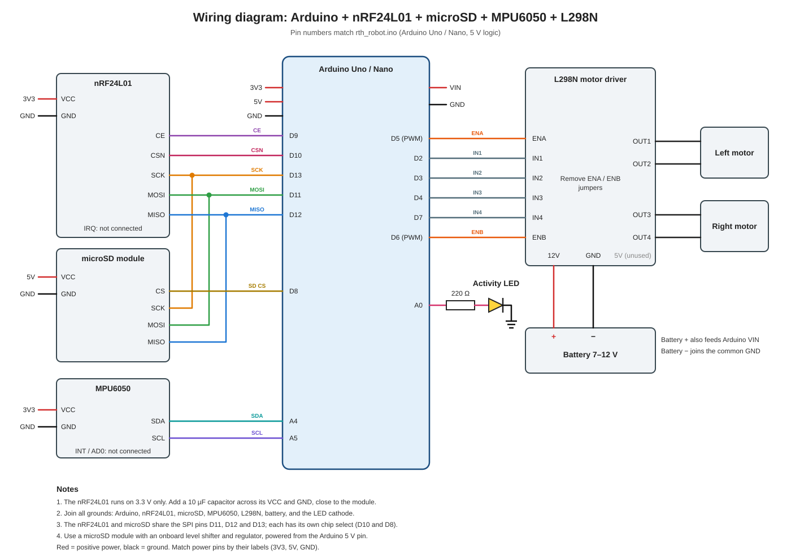

[README.md](https://github.com/user-attachments/files/34612498/README.md)
# RC Return-to-Home Robot

A two-part Arduino project: a handheld **joystick controller** and a tank-drive **robot**, linked by nRF24L01 radios. The robot tracks its position with gyro-based dead reckoning, logs motion data to a microSD card, and can drive itself back to its starting point on command or when the radio link drops.

> **Status:** neither sketch has been compiled or tested on hardware by the author of this README. Verify against your board and library versions, and test with the wheels lifted before a real run.

## Files

| File | Description |
|---|---|
| `controller.ino` | Handheld controller firmware (transmitter) |
| `controller_wiring.svg` | Controller wiring diagram |
| `rth_robot.ino` | Robot firmware (receiver) |
| `rth_robot_wiring.svg` | Robot wiring diagram |
| `README.md` | This file |

The Arduino IDE expects each `.ino` file to sit in a folder with the same name (for example `controller/controller.ino`), so create one folder per sketch before opening them.

## How the system works

```
 [Joysticks] -> Controller (Uno + nRF24L01) ~~~ radio ~~~> Robot (Uno + nRF24L01)
                                                              |-> L298N -> two motors
                                                              |-> MPU6050 (heading)
                                                              |-> microSD (log)
```

The controller reads two joysticks and two stick buttons about 50 times a second and sends them as one packet. The robot turns that packet into tank-drive motor commands.

## Features

**Controller**

- Two analog joysticks: each stick's Y axis drives one side of the robot (tank drive)
- Deadzone around center so the motors don't twitch at idle
- Two stick buttons for return-to-home and origin reset (read as active-low with the internal pull-ups enabled)
- Status LED that blinks while the controller loop runs and stays solid if the radio fails to start

**Robot**

- Manual tank drive, range-limited, with a motor deadband
- Dead-reckoning position estimate relative to a "home" origin
- Autonomous return-to-home (RTH): pivots toward home, then drives forward with proportional steering
- Link-loss failsafe: if no radio packet arrives for 500 ms, RTH starts automatically
- Persistent CSV logging to microSD (file stays open, flushed once per second)
- Activity LED that blinks while packets arrive and enough free RAM remains
- Startup self-checks with blink codes for a missing MPU6050 or radio

## Hardware

**Controller**

- Arduino Uno or Nano
- nRF24L01 radio module, plus a 10 µF capacitor
- Two analog joystick modules with push buttons (GND, +5, VRx, VRy, SW pins)
- One LED and one 220 Ω resistor
- USB or battery power

**Robot**

- Arduino Uno or Nano (5 V logic, ATmega328P)
- nRF24L01 radio module, plus a 10 µF capacitor
- MPU6050 breakout (for example GY-521)
- microSD module with onboard level shifter and regulator
- L298N dual motor driver
- Two DC gear motors
- Battery, 7 to 12 V
- One LED and one 220 Ω resistor

## Wiring

### Controller


| Function | Arduino pin |
|---|---|
| nRF24L01 CE | D9 |
| nRF24L01 CSN | D10 |
| nRF24L01 SCK / MOSI / MISO | D13 / D11 / D12 |
| Left joystick VRy (left motor) | A1 |
| Right joystick VRy (right motor) | A0 |
| Left joystick button (SW) | D2 |
| Right joystick button (SW) | D3 |
| Status LED (through 220 Ω to GND) | D6 |
| Joystick +5 pins | 5V |
| Joystick and nRF24L01 GND | GND |
| nRF24L01 VCC | 3V3 |

Notes:

- The VRx pins (horizontal axis) are not used.
- The nRF24L01 IRQ pin is not connected.
- The nRF24L01 must be powered from **3.3 V**, not 5 V.
- The 10 µF capacitor goes **across the module's VCC and GND**, close to the module. In the drawing, 3V3 feeds the VCC pin directly and one capacitor leg is on that supply line, while the other leg joins the radio's GND wire.

### Robot



| Function | Arduino pin |
|---|---|
| nRF24L01 CE | D9 |
| nRF24L01 CSN | D10 |
| microSD CS | D8 |
| SPI SCK / MOSI / MISO (shared by radio and SD) | D13 / D11 / D12 |
| MPU6050 SDA / SCL | A4 / A5 |
| L298N ENA (left PWM) | D5 |
| L298N IN1 / IN2 (left direction) | D2 / D3 |
| L298N IN3 / IN4 (right direction) | D4 / D7 |
| L298N ENB (right PWM) | D6 |
| Activity LED (through 220 Ω to GND) | A0 |

Important:

- The nRF24L01 must be powered from **3.3 V**, with a 10 µF capacitor across its power pins.
- Join all grounds: Arduino, radio, SD, MPU6050, L298N, battery, and LED.
- Remove the ENA and ENB jumpers on the L298N so PWM controls motor speed.
- If a motor spins the wrong way, swap its two output wires.

## Software setup

1. Install the Arduino IDE.
2. Install these libraries from the Library Manager:
   - **RF24** (by TMRh20), needed by both sketches
   - **MPU6050_light**, needed by the robot only
3. `SPI`, `Wire`, and `SD` come with the IDE.
4. Upload `controller.ino` to the controller board and `rth_robot.ino` to the robot board.
5. Keep the robot **perfectly still** while it boots. The gyro calibrates for a couple of seconds, and the direction the robot faces at that moment becomes "forward" (+X).

## Radio link

Both sketches use the same pipe address (`0xE8E8F0F0E1`), low power level (`RF24_PA_LOW`), and this packet:

```cpp
struct PacketData {
  int motorLeftSpeed;    // -255 to 255
  int motorRightSpeed;   // -255 to 255
  bool leftButton;       // left stick button (true = pressed)
  bool rightButton;      // right stick button (true = pressed)
};
```

If you change the struct, change it identically in both sketches. `int` is 2 bytes on Uno and Nano but 4 bytes on some other boards (such as the ESP32), so a size mismatch between boards produces garbage values. Use the same type of board on both ends, or switch to fixed-width types like `int16_t`.

## Controls

| Input | Action |
|---|---|
| Left stick, forward/back | Left motor speed and direction |
| Right stick, forward/back | Right motor speed and direction |
| Left stick button (press) | Toggle return-to-home on or off |
| Right stick button (press) | Stop motors, set current position as new home (0, 0), cancel RTH, and clear the log file |

The robot triggers buttons on the rising edge, so holding one down counts as one press.

If pushing a stick forward drives that side backward, your joystick modules are mounted the other way around. Flip the sign in the controller's `map()` calls, for example `map(rawLeftY, 0, 1023, 255, -255)`.

## Controller details

- Stick positions (0 to 1023) are mapped to -255 to 255.
- Values within 25 of center are treated as zero.
- A packet goes out about every 20 ms, so roughly 50 per second.
- The controller does not check whether the robot received a packet. Its LED shows that the controller is running, not that the link works.

## Robot details

**Position tracking.** Heading comes from the MPU6050 gyro (yaw). Speed is estimated as the average motor command times `SPEED_SCALE`, and position is integrated each loop along the current heading. There are no wheel encoders, so position drifts over time.

**Return-to-home.** The robot compares its heading with the direction to (0, 0):

- If the heading error is more than about 29° (`PIVOT_THRESHOLD`), it pivots in place.
- Otherwise it drives forward at `RTH_BASE_SPEED` with proportional steering.
- It stops when it is within `ARRIVAL_RADIUS` of home and returns to manual mode.

**Failsafe.** If packets stop arriving for `LINK_TIMEOUT_MS` (500 ms), RTH starts automatically. After arriving, the motors stay stopped until the link returns. If the link returns mid-return, the robot keeps heading home, and pressing the left stick button cancels it.

**Robot deadband.** The robot zeroes any command below `DEADBAND` (40), on top of the controller's deadzone of 25, so small stick movements between 25 and 39 do nothing.

## LEDs and error codes

| Device | LED behavior | Meaning |
|---|---|---|
| Controller | Blinking (about 4 to 5 per second) | Controller loop is running |
| Controller | Solid on | Radio failed to start; reset after fixing the wiring |
| Robot | Blinking about 5 times per second | Packets are arriving normally |
| Robot | Off while the controller is on | No packets, link lost, or free RAM below `MIN_FREE_RAM` (200 bytes) |
| Robot | 2 blinks, pause, repeat | MPU6050 not found (robot halts) |
| Robot | 3 blinks, pause, repeat | nRF24L01 not detected (robot halts) |

If the SD card fails to initialize, the robot still drives but does not log. There is no blink code for this.

## SD log format

The log is `vec.csv` in the card root, written every 100 ms:

```
t,ax,ay,az,gx,gy,gz,x,y
```

- `t`: milliseconds since boot
- `ax, ay, az`: acceleration (g)
- `gx, gy, gz`: angular rate (degrees per second)
- `x, y`: estimated position (distance units)

The header is written only when the file is created. Runs are appended to the same file until you reset the log with the right stick button. Data is flushed once per second, so the last second can be lost if power is cut.

## Tuning (robot)

All settings are constants near the top of `rth_robot.ino`.

| Constant | Purpose |
|---|---|
| `SPEED_SCALE` | Converts motor command to distance per second. Measure your robot's real speed and adjust. |
| `DEADBAND` | PWM below this value does not move the motors; treated as zero |
| `ARRIVAL_RADIUS` | How close to home counts as arrived (in `SPEED_SCALE` distance units) |
| `HEADING_SIGN` | Set to `-1.0` if turning left makes the angle decrease |
| `PIVOT_THRESHOLD`, `PIVOT_SPEED` | When and how fast RTH turns in place |
| `RTH_BASE_SPEED` | Forward speed during RTH |
| `LINK_TIMEOUT_MS` | How long without packets triggers the failsafe |
| `LOG_INTERVAL_MS`, `FLUSH_INTERVAL_MS` | Logging rate and SD flush rate |
| `PACKETS_PER_TOGGLE` | How many packets between LED toggles |
| `MIN_FREE_RAM` | Minimum free RAM for the activity LED to blink |

Suggested first test: lift the wheels, drive manually, press the left stick button, and confirm the wheels turn the way the robot would need to head home. If they turn the wrong way, flip `HEADING_SIGN`.

## Known issues

- **Dead reckoning drifts.** The gyro alone drifts several degrees per minute, and motor speed varies with battery voltage and load, so RTH accuracy gets worse the longer you drive. Wheel encoders and a magnetometer would improve it a lot.
- **Stalls count as movement.** A stalled or slipping robot still counts as moving in the position estimate.
- **Tight memory.** An Uno or Nano with the SD, RF24, and MPU libraries loaded together has little RAM left. If you see random resets, check the compile output for RAM use.
- **SD writes can stall the loop.** Slow cards can delay the control loop. A better card or a lower log rate helps.

## Troubleshooting

| Symptom | Likely cause |
|---|---|
| Controller LED solid on | Radio not detected: check wiring, the 3.3 V supply, and the capacitor |
| Robot LED blinks 2 times, repeating | Check MPU6050 power and SDA/SCL wiring |
| Robot LED blinks 3 times, repeating | Check radio wiring, 3.3 V supply, and the 10 µF capacitor |
| Robot doesn't move in manual mode | No packet received yet, wrong address, or mismatched struct |
| Robot toggles RTH or clears its log by itself | Controller button pins floating; `controller.ino` must enable `INPUT_PULLUP` on D2 and D3 |
| Motors run at full speed only | ENA/ENB jumpers still installed on the L298N |
| Robot spirals instead of heading home | `HEADING_SIGN` wrong, or gyro not calibrated (robot moved at boot) |
| No log file | SD module not initialized; check wiring, card format (FAT16/FAT32), and CS pin |
| Radio drops out | Add the 10 µF capacitor correctly, shorten wires, or reduce the distance |
